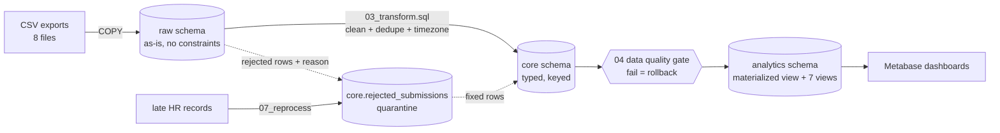
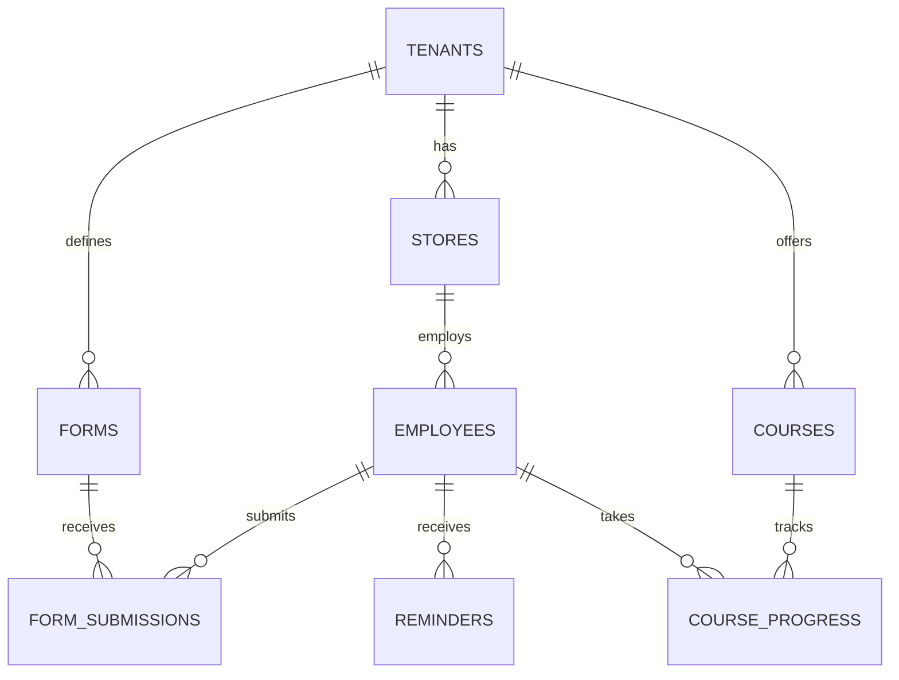
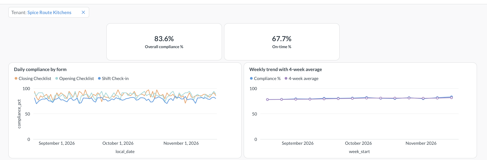
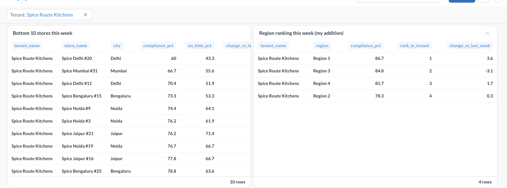
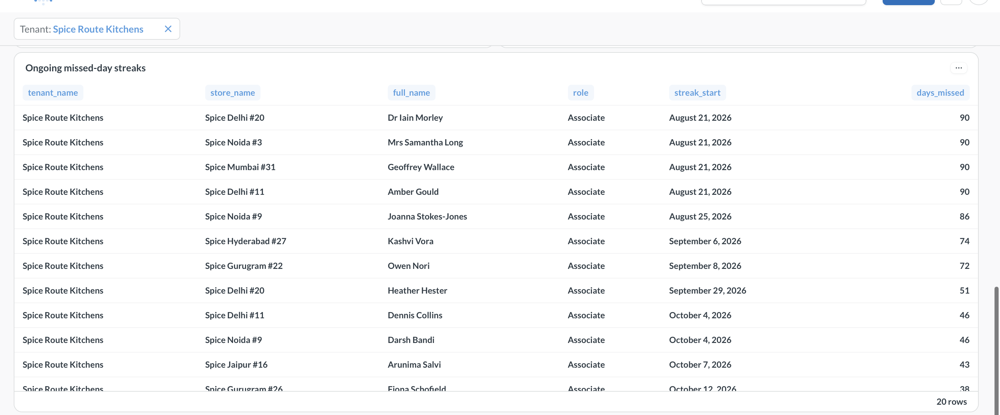
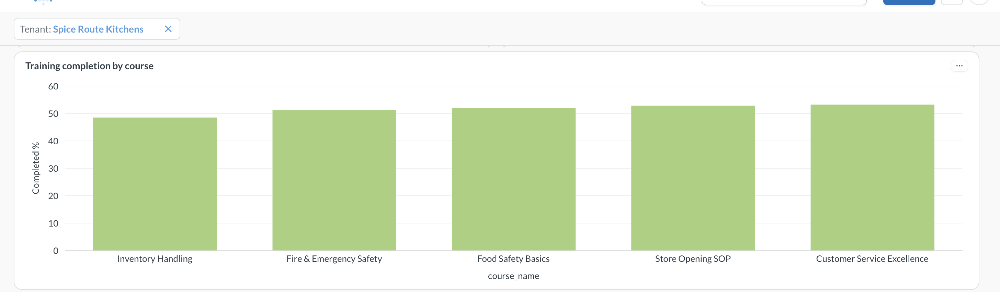

# Multi-Tenant Field Operations Analytics

An end-to-end analytics pipeline for a SaaS platform where retail, restaurant and hospitality companies run daily checklists, staff check-ins, reminders and training for their store teams.

It answers the questions operations managers ask every morning: **Which stores aren't completing their checklists? Who has missed several days in a row? Do reminders actually work? Is training getting done?**

Built with **PostgreSQL, SQL, Python and Metabase**, running locally with Docker.

> All data is synthetic, generated by `src/generate_data.py`. Company names, people and stores are fictional.

---

## The business problem

A field-operations platform serves several client companies (tenants). Each tenant has stores in different cities and **different timezones**, and expects:

- an **Opening Checklist** (due 10:00) and a **Closing Checklist** (due 23:00) from every store, every day
- a **Shift Check-in** (due 12:00) from every active employee, every day
- **reminders** before the due time, and **escalations** to the manager after a miss
- **training courses** completed by every employee

Raw data from the field is messy: the same submission arrives twice, phones with wrong clocks send timestamps from the future, new joiners submit forms before their HR record exists, and status values come in five spellings. Dashboards built straight on that data would be wrong.

## Architecture



| Layer | Purpose |
|---|---|
| `raw` | Lands CSVs exactly as received. No keys, so bad rows can be inspected instead of failing the load. |
| `core` | Clean, typed tables with primary and foreign keys. Local date and time are calculated once, in each tenant's timezone. |
| `core.rejected_submissions` | Quarantine: every rejected row with its reason, so it can be fixed and reprocessed. |
| `analytics` | A materialized "expected vs actual" fact plus views built for dashboards. |
| `pipeline_runs` | One row per run with status, row counts and any error, for monitoring. |

## Data model



**Data size (default settings):** 8 tenants, 284 stores, 1,989 employees, 90 days of history. 183,850 raw submissions, 91,569 reminders and 8,133 training records, and 219,468 expected submissions in the analytics fact. Use `--scale` and `--days` to generate more.

## What the pipeline does

### 1. Cleaning and quarantine

Rules are applied in order, and every rejected row is kept with its reason:

| Rule | Rows rejected |
|---|---:|
| `duplicate_submission`: second submission for the same form, store/employee and **local** day (keep the earliest) | 2,227 |
| `exact_duplicate`: same submission ID loaded twice | 1,129 |
| `unknown_employee`: employee not in HR data (orphan) | 201 |
| `future_timestamp`: device clock ahead of real time | 184 |

Status text is standardised (`" Completed "`, `"COMPLETE"` → `completed`). 180,234 clean submissions reach `core`.

### 2. Data quality gate

`sql/04_data_quality_checks.sql` runs after every load. Checks on `raw` report what came in. Checks on `core` must all return 0, and include a reconciliation check (**raw = core + quarantine**, so no row is silently lost). If any core check fails, the **whole run rolls back** and is logged as failed. This caught a real bug during development: reprocessing let through a row that had both an unknown employee and a future timestamp, because it only rechecked the first rule.

### 3. Reprocessing late-arriving data

Some new joiners submit forms before HR adds them. Once their records arrive (`data/late_arriving/late_employees.csv`), `python src/run_pipeline.py --reprocess` re-validates the quarantined rows against **every** rule and moves the valid ones into core, **without rerunning the full pipeline**. In the default dataset, 117 of 241 orphan rows were recovered. The script is idempotent: running it again changes nothing.

### 4. Timezone-correct reporting

Timestamps are stored in UTC. "Was this on time?" and "which day was it?" depend on the tenant's timezone (Kolkata, Dubai, London, New York, Sydney…). The transform computes `local_date`, `is_on_time` and `is_odd_hour` once with `AT TIME ZONE`, so every dashboard agrees. A business-day cutoff stops a late closing checklist from counting as the next day.

### 5. Analytics: measuring what's missing

A missed checklist leaves no row behind, so compliance can't be calculated from submissions alone. The materialized view `analytics.fact_expected_vs_actual` builds every **expected** submission (each open store and each active employee, every day, respecting join and leave dates) and LEFT JOINs actual submissions onto it.

| View | Question it answers | SQL techniques |
|---|---|---|
| `daily_compliance` | What % of expected forms were submitted, and on time? | `COUNT(*) FILTER`, conditional aggregation |
| `store_weekly_ranking` | Which stores are best and worst this week, and are they improving? | `RANK`, `NTILE`, `LAG` |
| `employee_missed_streaks` | Who missed 3+ days in a row, and is it still happening? | gaps and islands with `ROW_NUMBER` |
| `reminder_effectiveness` / `reminder_summary` | Do reminders lead to submissions, and how fast? | `LATERAL` join, `PERCENTILE_CONT` |
| `training_funnel` | How many employees start and finish each course? | funnel aggregation, date arithmetic |
| `weekly_trend` | Is compliance going up or down? | `LAG`, 4-week rolling average with window frames |
| `data_quality_summary` | How much bad data arrived, and how much was recovered? | |
| `region_weekly_compliance` | Which regions are best and worst each week, and are they improving? | `RANK`, `LAG`, join to store attributes |

**Headline numbers:** overall compliance is 82.1%, and only 66.8% of expected forms arrive on time.

### 6. Query performance

Indexes in `sql/06_indexes.sql` were chosen from the real query patterns (equality column first, then the date range). `src/benchmark.py` measures each query with `EXPLAIN ANALYZE` (median of 15 runs) before and after:

| Query | Before (ms) | After (ms) | Improvement | Scan before | Scan after |
|---|---:|---:|---:|---|---|
| Store manager view - one store, last 14 days | 3.94 | 0.03 | 141x (99.3% less time) | Seq Scan | Index Scan |
| Support troubleshooting - one employee's latest submissions | 3.61 | 0.01 | 516x (99.8% less time) | Seq Scan | Index Scan |
| Tenant dashboard - daily volume for the last 7 days | 3.61 | 0.25 | 14x (93.0% less time) | Seq Scan | Index Scan |
| Reminder follow-up - one tenant, one week | 25.51 | 2.63 | 10x (89.7% less time) | Seq Scan | Bitmap Heap Scan, Bitmap Index Scan |

Full results: [`docs/benchmark_results.md`](docs/benchmark_results.md). Times are from a laptop and will vary.

## Dashboards

<!-- Replace these with your own screenshots after building the dashboard -->
| Compliance overview | Store ranking |
|---|---|
|  |  |

| Missed-day streaks | Reminders and training |
|---|---|
|  |  |

## How to run it

Requirements: [Docker Desktop](https://www.docker.com/products/docker-desktop/), Python 3.10+ and Git.

```bash
git clone https://github.com/Shreyaa-lab/field-ops-analytics.git
cd field-ops-analytics

docker compose up -d                       # PostgreSQL on :5432, Metabase on :3000
pip install -r requirements.txt

python src/generate_data.py                # create synthetic CSVs in data/raw
python src/run_pipeline.py                 # load, clean, check, build analytics
python src/run_pipeline.py --reprocess     # recover rows once late HR records arrive
python src/benchmark.py                    # measure index impact
```

Then open http://localhost:3000, connect Metabase to PostgreSQL (host `postgres`, database `fieldops`, user and password `analyst`) and build dashboards on the `analytics` schema.

## Project structure

```
field-ops-analytics/
├── docker-compose.yml          PostgreSQL + Metabase
├── requirements.txt
├── src/
│   ├── generate_data.py        synthetic data with injected quality problems
│   ├── run_pipeline.py         orchestration, transaction, run logging, reprocessing
│   └── benchmark.py            EXPLAIN ANALYZE before/after indexes
├── sql/
│   ├── 00_pipeline_runs.sql    run log table
│   ├── 01_raw_schema.sql       landing tables
│   ├── 02_core_schema.sql      clean tables with keys + quarantine
│   ├── 03_transform.sql        cleaning, dedupe, timezone logic
│   ├── 04_data_quality_checks.sql
│   ├── 05_analytics_views.sql  materialized fact + dashboard views
│   ├── 06_indexes.sql
│   ├── 07_reprocess_rejected.sql
│   └── benchmark_queries.sql
├── data/sample/                20-row samples of each file
└── docs/
    ├── benchmark_results.md
    └── screenshots/
```

## Design decisions

- **Full refresh, not incremental.** At this size, rebuilding `core` each run is simple and idempotent. At larger volumes I would switch to incremental loads keyed on `submitted_at` with a watermark.
- **Quarantine instead of delete.** Rejected rows are evidence. Keeping them with a reason makes data quality measurable and makes reprocessing possible.
- **Materialized view for the expected-vs-actual fact.** It joins every expected subject-day to submissions, which is too heavy to recompute on every dashboard load. It is refreshed after each pipeline run.
- **Local time computed once.** Doing timezone conversion in each dashboard query invites inconsistent answers. Storing `local_date` also makes it indexable.
- **One transaction per run.** A half-finished load is worse than yesterday's complete data, so any failure rolls back everything.

## What I'd add next

- Incremental loading with a watermark, and partitioning `form_submissions` by month
- dbt models and tests in place of the SQL scripts
- Airflow or a cron schedule to run the pipeline daily
- Alerts when a data quality check fails
